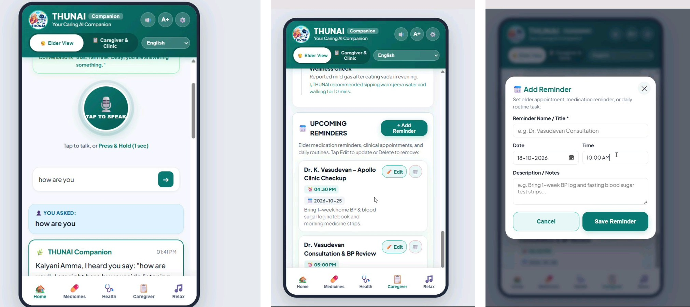

# THUNAI (துணை) – Senior Companion
### Your Companion, Your Comfort.

**Team:** Error404: experience not found
**Hackathon:** DEXATHON 2K26
**Status:** Working prototype

THUNAI is a voice-first AI companion for older adults, with Tamil, English and Tanglish conversation, reminders, family contacts and relaxation music.

## Documentation
| Document | What it covers |
|---|---|
| [Abstract](docs/ABSTRACT.md) | Project summary |
| [Problem and solution](docs/PROBLEM_AND_SOLUTION.md) | The problem, our approach, impact and limits |
| [Features](docs/FEATURES.md) | Feature status and safety notes |
| [Architecture](docs/ARCHITECTURE.md) | How the parts fit together |
| [Testing](docs/TESTING.md) | Prototype testing checklist |
| [Demo script](docs/DEMO_SCRIPT.md) | Short presentation script |
| [Publish checklist](docs/INTEGRATION.md) | Steps before making the repository public |

# THUNAI – Your Caring AI Companion

### An AI-Powered Elderly Care Assistant

THUNAI is a voice-first AI companion designed to support elderly individuals through accessible technology, personalised assistance, and caregiver connectivity.

---

## 📱 Application Screenshots

Explore THUNAI's user-friendly interface, including AI-powered conversations, appointment reminders, and reminder scheduling.

<p align="center">
  
</p>

### Features Demonstrated
- Voice-based AI interaction
- Elder-friendly user interface
- Personalised conversations
- Appointment and medication reminders
- Reminder creation and management
- Caregiver assistance

---

### THUNAI – Technology with Care ❤️


## Demo
- Live application: https://drive.google.com/file/d/1ojWFUi7w9lIoCppUvznsZZ-5VBfxAfiZ/view?usp=drivesdk

## Technology stack
- **Backend:** Python (built-in `http.server`)
- **Frontend:** HTML, CSS and JavaScript single-page PWA
- **AI (optional):** Google Gemini 2.5 Flash through the `google-genai` SDK, with built-in offline rules as a fallback
- **Speech:** browser Speech Recognition and Speech Synthesis, plus `gTTS` for Tamil / English audio
- **Desktop window:** Edge or Chrome app mode, with `pywebview` as a fallback

## Source code files

### Frontend (what the user sees)
| File | Purpose |
|---|---|
| `index.html` | The app interface (PWA) |
| `manifest.json` | PWA settings |
| `sw.js` | Service worker for offline use |
| `icon-192.png` | App icon (192×192) |
| `icon-512.png` | App icon (512×512) |

### Backend (Python server)
| File | Purpose |
|---|---|
| `server.py` | Web server and API |
| `agent_brain.py` | Language detection, intents, replies |
| `medicine_scanner.py` | Medicine label analysis |
| `state.py` | Profile, reminders, music library and saved data |

### Setup and desktop app
| File | Purpose |
|---|---|
| `requirements.txt` | Python packages to install |
| `thunai_app.py` | Desktop launcher |
| `icon.ico` | Desktop app icon |

Keep all of these files in the same folder, because the server loads the frontend files from its own folder.

## Run locally
Requires Python 3.10 or newer.

```bash
pip install -r requirements.txt
python server.py
```

Open http://localhost:8080 (the server uses port 8085 if 8080 is busy). To open a desktop-style window instead, run `python thunai_app.py`.

### Optional: enable Gemini
Set the `GEMINI_API_KEY` environment variable before starting the server, or paste a key in the app under **Settings**.

**Never commit API keys or `.env` files to this repository.**

## 👥 Team Error404: Experience Not Found

| Team Member | Role |
|---|---|
| Abinaya A.K. | Frontend & Backend Development |
| Anthony Anushka.V | Frontend & Backend Development |
|  Antony Clarus Nivytha . P | Documentation & Presentation |
| Arini.K| GitHub & Version Control |
| Aishwarya.B | Research & Content Development |
| M.Divya bharathi | Presentation Design & Visual Communication |

## License
No license selected yet. Agree on one as a team before adding a `LICENSE` file.
